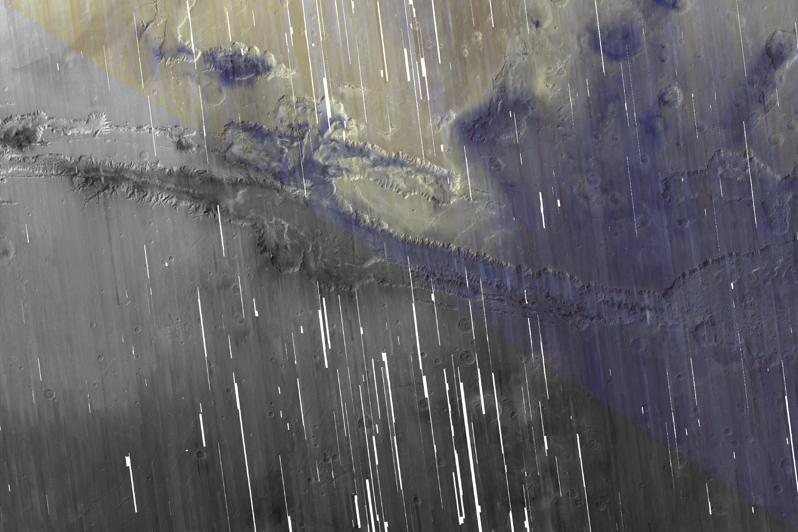

# VRDR Resampler for CaSSIS


The entire MC18 quadrant resampled to CaSSIS NPB (top right) and PAN (bottom left) browse products. Learn more about Mars through the colours of CaSSIS [here](https://www.esa.int/Science_Exploration/Human_and_Robotic_Exploration/Exploration/ExoMars/Red_Mars_blue_Mars_through_the_eye_of_a_Mars-orbiting_camera).

## Table of Contents

- [About](#about)
- [Getting Started](#getting_started)
- [Usage](#usage)
- [Contributors](#contributors)

## About <a name = "about"></a>

This is a simple Python module for resampling the CRISM VRDR dataset, of hyperspectral visible-to-near-infrared observations of Mars at a 90 m/px resolution, to the spectral sampling of the CaSSIS multispectral imager.

You can find out more about the CRISM VRDR dataset here: [CRISM VRDR](https://ode.rsl.wustl.edu/Venus/pagehelp/Content/Missions_Instruments/Mars%20Reconnaissance%20Orbiter%20(MRO)/CRISM/CRISM%20Product%20Primer/CRISM%20VRDR.htm).

Here is the official DOI of the VRDR dataset: [10.17189/tt67-sj14](https://pds.nasa.gov/ds-view/pds/viewDataset.jsp?dsid=MRO-M-CRISM-5-RDR-VNIRHYPERSPECTRAL-V1.0).

This module has been used to construct the CaSSIS-VRDR-Resampled Dataset ("CaRDR"), available at the [Natural History Museum Data Portal](https://doi.org/10.5519/tbyp7pu2), and as described by [McNeil & Stabbins (2026)](https://doi.org/10.1029/2026EA005243).

This dataset provides a near-global view of Mars as seen through the CaSSIS spectral channels (BLU, PAN, RED, NIR). The dataset mirrors the VRDR arrangement, by Mars quadrant, and then by individual tiles within each quadrant. All georeferencing and metadata of the original VRDR dataset is preserved in the resampling process. We provide the CaSSIS resampled products (I/F 4-band float cubes, spectral parameter ratio cubes, and 1% linear stretch 24-bit colour browse products) as geotiffs.

## Getting Started <a name = "getting_started"></a>

### Downloading the VRDR Dataset

A significant part of the resampling project is simply downloading a local copy of the entire VRDR data `vrral` (Lambert Albedo) products. This can be achieved with the `download_vrral_all.sh` script. Please note the entire dataset is ~5.5 Tb, so sufficient storage is required. This script requires `lftp`, `wget` and GNU `parallel` to run.

### Environment Setup

We're yet to package the module into an installable conda/pip package.

For now, to get this code working for yourself, you can either zip download the repository, or git clone it, and by creating a new conda environment from the provided `environment.yml` file. i.e. by running

```
conda env create -f environment.yml
```

from within the downloaded `vrdr_resampler` directory.

### Running the Notebook Example

The main resampling code is in the `vrdr_resampler.py` module.

The `vrdr_resampler_cassis.ipynb` provides a walk-through for using the module to perform resampling to the CaSSIS filter profiles. These are provided in the `instrument_response` directory. The data has been digitised from [Pommerol et al 2022](https://doi.org/10.1016/j.pss.2022.105580). The notebook also uses the `cassis_products.py` module, that provides CaSSIS-specific functions for producing browse products and spectral parameters (summary products) and colour composite products.

First the notebook walks through the steps for:
1. Loading a VRDR Tile from a given Quadrant
2. Loading the CaSSIS band spectral response profiles
3. Applying the CaSSIS spectral response profiles to the VRDR tile
4. Exporting the resampled (4-band) CaSSIS VRDR Tile to a float32 I/F GeoTIFF with ENVI header
5. Producing 24-bit colour CaSSIS Browse Products for the tile, and exporting these to GeoTIFFs
6. Computing a float32 Spectral Parameter (Summary Product) stack, and exporting this to GeoTIFF, with an ENVI header
7. Producing 24-bit colour composite CaSSIS Browse Products, and exporting these to GeoTIFFs
   
At the end of the notebook, a cell is provided that runs the outlined steps iteratively over all quadrants and tiles of the downloaded `vrdr` dataset.

Note that sufficient storage is required to host the processed products, of ~33 Gb per quadrant, or ~1 Tb in total.

A final notebook cell is given that finds quadrant-wide browse product stretch parameters, and applies these to produce a further set of browse products. This allows for an entire quadrant of tiles to be loaded into a GIS suite with preset stretch parameters that minimise brightness offsets between neighbouring tiles. The example image in this readme is an example of such a set of browse products.

## Usage <a name = "usage"></a>

As of 11/11/2025, we have downloaded the entire VRDR dataset and have batch-processed most of it to the CaSSIS profiles.

The CaSSIS-resampled data products are available at the [Natural History Museum Data Portal](https://doi.org/10.5519/tbyp7pu2).

We have plans to run the code on other VNIR instrument responses, e.g. HRSC for Mars Express, OROCHI for MMX.

If you would like help resampling to another VNIR instrument, feel free to get in touch.

## Contributors <a name = "contributors"></a>

This project was formulated and carried out by Joe McNeil and Roger Stabbins, at the Natural History Museum, London, UK, October-Novemeber 2025.

The software was developed by Roger Stabbins: [r.stabbins@nhm.ac.uk](r.stabbins@nhm.ac.uk)
